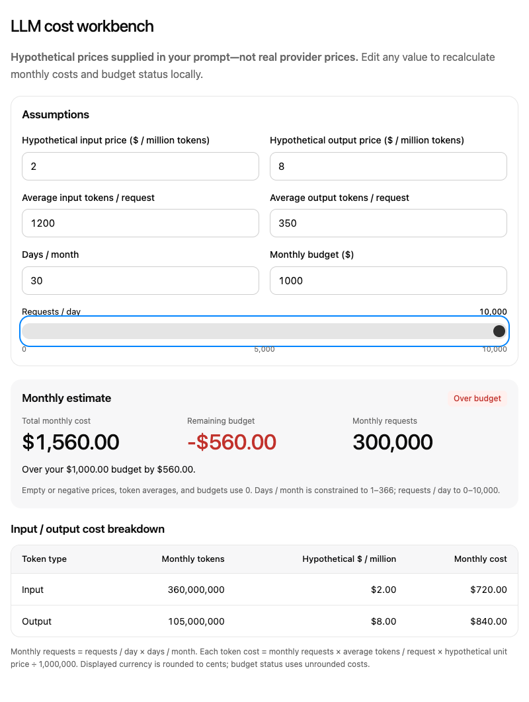
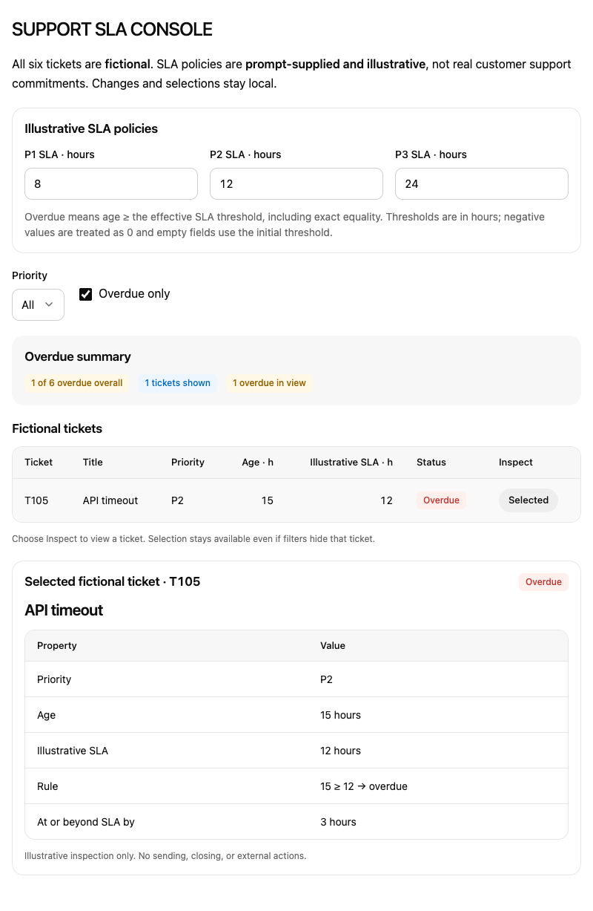
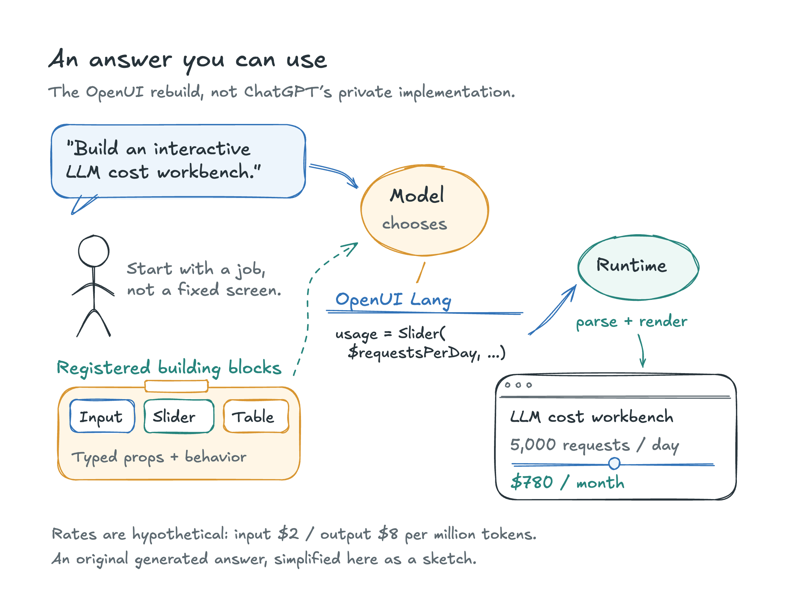
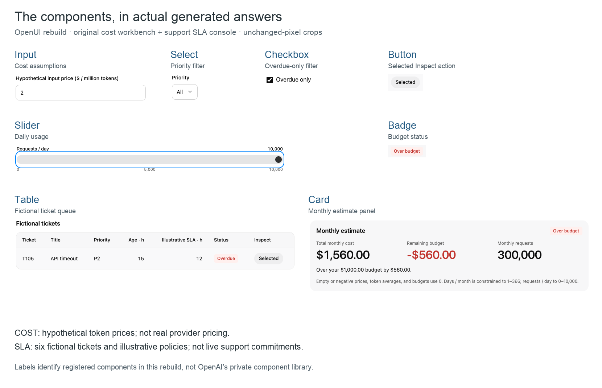

# OpenUI Tutorial

**Turn a chat request into an interactive answer using a component library, OpenUI Lang, and React.** This Next.js application can produce editable calculators, filterable tables, charts, maps, and small working tools. An optional Research Preview adds a narrower, source-backed comparison workflow.

## TL;DR

- Use **Node 24+**, install with `npm ci`, and configure a model connection with server-only environment variables.
- The model composes registered components into OpenUI Lang. The renderer mounts React components; reactive state lets inputs update the answer locally.
- **Chat** progressively relays model output. **Research Preview** retrieves evidence, buffers generation, validates the complete comparison, and then delivers it.
- The tested direct setup uses `https://api.openai.com/v1` and `gpt-6.1-sol`, with streaming Chat Completions converted to Responses events. It has no Cloud correction step.
- This is a **local, single-process demo without account authentication**. Outputs vary, source citations do not prove claims, and local limits do not guarantee API spending.

Repository: [unicodeveloper/openuitutorial](https://github.com/unicodeveloper/openuitutorial).

### Credits and scope

This tutorial builds on the **[Open Intelligent UI starter by Thesys](https://github.com/thesysdev/open-intelligent-ui)** and the **[OpenUI framework](https://github.com/thesysdev/openui)**. The starter supplies the chat experience, component primitives, styling, local storage, gallery, and supporting integrations. Preserve its upstream credits when adapting this project.

This project is **independent and not affiliated with or endorsed by OpenAI**. It explores the interactive-answer experience associated with Intelligent UI; it does not claim access to or reverse engineering of closed ChatGPT internals.

## What this project teaches

A text answer can tell you a monthly cost. An interactive answer can let you change usage and immediately see a new cost. A support summary can become a console where changing a policy recalculates overdue tickets and filters the table.

The important boundary is between generation and interaction: a model request creates the interface program, then bound controls and expressions can operate locally. Sending a follow-up question makes another model request. Explicit network-enabled components and actions can also make requests, so local reactivity does not mean every possible answer is offline.





These are recorded outputs. Fresh generations can differ in layout, labels, component choices, and correctness. The examples below describe acceptance targets, not guaranteed identical output or parity with another product.

## Quick start

### 1. Install the locked dependencies

```sh
git clone https://github.com/unicodeveloper/openuitutorial.git
cd openuitutorial
node --version
npm --version
npm ci
```

Use **Node 24 or newer**. The recorded environment used Node 24.12.0 and npm 11.6.2. Keep the committed `package-lock.json`: the accepted clean installation includes repaired optional esbuild dependency entries.

### 2. Configure the model on the server

Create `.env.local` at the repository root in your editor. Replace this safe placeholder privately with credentials from your own provider account:

```dotenv
LLM_BASE_URL=https://api.openai.com/v1
LLM_API_KEY=<your-provider-api-key>
LLM_MODEL=gpt-6.1-sol
LLM_REASONING_EFFORT=default
```

This is the tested direct OpenAI setup. Model availability depends on your account; use an available compatible model if that ID is unavailable. `default` means **omit the reasoning-effort override**. The route falls back to `low` when the variable is absent, so set it explicitly for this setup. No speed or quality comparison is implied.

Keep keys server-only. Never put them in `NEXT_PUBLIC_` variables, browser code, prompts, screenshots, or Git. Restart development after changing configuration.

### 3. Generate contracts, check, and run

```sh
npm run generate
npm run generate:research
npm run prompt
npm test
npm run typecheck
npm run build
npm run dev -- --webpack --hostname 127.0.0.1 --port 3217
```

Open **http://127.0.0.1:3217/** and select **Chat**. Stop the server with Ctrl-C. Browser acceptance used this Webpack/loopback configuration; default Turbopack development startup was not established by those checks.

Generation and checks need no live provider requests. Installation downloads packages, and builds may fetch the configured Google font. The generation scripts serialize the component contracts and reference prompts; they do not ask a model to generate an answer. Submitting chat prompts can incur charges.

## How the pipeline works



1. **Component library:** `src/lib/library.ts` calls `createLibrary` to register components, functions, actions, component groups, and the `Col` root. Each component has a name and a Zod props schema.
2. **Prompt:** `npm run generate` serializes the library into `src/generated/spec.json`. In direct mode, the server calls `generateSystemPrompt` with that spec and the rules/examples from `src/lib/prompt-options.ts`. Trusted instructions come from the server.
3. **OpenUI Lang:** the model emits an assignment-based program, not a new React source file. Component calls use positional arguments in schema order, and statements can reference other statements or reactive variables.
4. **Renderer:** `AgentInterface` receives the response and uses the selected component library to mount the real React views.
5. **Reactive state:** controls update `$variables`; expressions and registered `@functions` recompute the values that depend on them.

For example, this program uses existing components:

```text
root = Col([amount, summary])
$requests = 5000
amount = Input($requests, "Requests per day", "number")
summary = Text($requests + " requests per day")
```

`root` identifies the rendered tree. The first `Input` prop is reactive, so passing `$requests` creates a binding. The summary reads that variable and updates locally. Consult this project's generated contract for exact argument positions; another OpenUI library can expose different signatures.

Actions such as `@Set` and `@Reset` change state. `@ToAssistant` deliberately sends a follow-up interaction, while `@CopyToClipboard` reaches the application's action handler. A button without an explicit action can send its label to the assistant, so explicitly request local actions when building a tool that must not make another model call.

`src/app/page.tsx` connects `fetchLLM`, `openAIConversationMessageFormat`, and `openAIResponsesAdapter` to `/api/chat`. Direct mode converts upstream Chat Completions chunks into Responses-shaped server-sent events. That conversion does **not** mean the upstream request uses the Responses API. Progressive transport also does not guarantee immediate first paint: references can be unresolved while streaming, and `HtmlView` waits until completion.

## Chat and Research Preview

| | Chat | Research Preview |
| --- | --- | --- |
| Job | General interactive answers and local tools | Small comparisons based on retrieved excerpts |
| Library | Broad normal component library | Only `Col` and custom `ResearchComparison` |
| Retrieval | No general research search step; media/maps have separate integrations | Server-side Valyu web search |
| Delivery | Progressive server relay | Buffered and validated before delivery |
| Interaction | Reactive controls and registered actions | Comparison selection/shortlisting and canonical evidence display |
| Storage | Browser namespace `oiu` | Separate namespace `oiu:research` plus temporary server snapshots |

Switch modes above the chat. Research conversations are separate from ordinary conversations. Seeing the Preview switch does not mean search credentials are configured.

## Example 1: hypothetical LLM cost workbench

**Problem:** explore usage assumptions against an illustrative $1,000 monthly budget. **Decision:** whether the proposed volume exceeds that budget. **Next action:** move the usage slider or edit assumptions. **Outcome:** the summary and breakdown recompute locally.

Paste this complete prompt into **Chat**:

```text
Build an interactive LLM cost workbench using these PROMPT-SUPPLIED HYPOTHETICAL unit prices, not real provider prices: input $2 per million tokens; output $8 per million tokens. Initial average input tokens/request: 1200; output tokens/request: 350; requests/day: 5000; days/month: 30; monthly budget: $1000. Clearly label the prices hypothetical. Use registered native editable numeric controls for both unit prices, both token averages, days/month and budget, plus a native usage slider for requests/day that can reach 10000. Show a monthly cost summary and an input/output cost breakdown table. Compute remaining budget and an over-budget status locally from reactive expressions as any input changes. Calculate all costs from the inputs; never hard-code computed totals. Use only native registered components, no HtmlView or images, no network actions or additional model calls for edits.
```

For each token type, monthly cost is `tokens/request × requests/day × days/month × rate / 1,000,000`. Add input and output costs, then subtract the total from the budget.

| State | Input cost | Output cost | Monthly total | Budget result |
| --- | ---: | ---: | ---: | --- |
| 5,000 requests/day | $360 | $420 | **$780** | $220 remaining |
| 10,000 requests/day | $720 | $840 | **$1,560** | $560 over budget |

The recorded browser check moved the native slider to 10,000 and observed the local update without new chat/research requests. These are prompt-supplied hypothetical prices, **not current provider rates**. A fresh generation still needs checking.

Inspect the saved generated answer: [llm-cost-workbench.lang](docs/tutorial/examples/llm-cost-workbench.lang).

## Example 2: fictional support SLA console

**Problem:** inspect a fictional queue under illustrative policies. **Decision:** which tickets meet the overdue rule. **Next action:** change a threshold, filter the queue, and inspect a ticket. **Outcome:** status, counts, visible rows, and selected details update without sending or closing tickets.

Paste this complete prompt into **Chat**:

```text
Build an interactive SUPPORT SLA CONSOLE using exactly SIX FICTIONAL tickets and PROMPT-SUPPLIED ILLUSTRATIVE policies, not real customers or support commitments. Tickets: T101, priority P1, age 6 hours, title 'Sign-in outage'; T102, P2, age 11 hours, 'Invoice mismatch'; T103, P3, age 3 hours, 'Export question'; T104, P1, age 2 hours, 'Webhook delay'; T105, P2, age 15 hours, 'API timeout'; T106, P3, age 20 hours, 'Documentation feedback'. Initial SLA thresholds: P1 4 hours, P2 12 hours, P3 24 hours. Define overdue strictly as age >= the editable SLA for that priority. Provide a native priority filter with All/P1/P2/P3, editable numeric SLA thresholds, a native overdue-only toggle, an overdue summary, a ticket table, and selectable ticket detail for inspecting the chosen ticket. Derive overdue status, filtering, counts and details locally with reactive state/expressions, not hard-coded counts. Clearly label all tickets fictional and policies illustrative. No sending, closing, network/tool actions, HtmlView or images; selecting/filtering/editing must not call a model.
```

Expected checks:

1. At thresholds of 4/12/24 hours, **two tickets are overdue: T101 and T105**.
2. Change P1 to 8 hours: **one ticket remains overdue, T105**.
3. Enable overdue-only and inspect T105.
4. Disable overdue-only and select P1: T101 and T104 should be visible.
5. A ticket exactly at its threshold is overdue because the rule is `age >= threshold`.

These controls were exercised on the recorded output without additional chat/research requests or renderer errors. They do not establish every control in every future answer, streaming first paint, or complete history restoration. All records are fictional and policies illustrative.

Inspect the saved generated answer: [support-sla-console.lang](docs/tutorial/examples/support-sla-console.lang).

## Model connection options

Provider selection lives in `src/app/api/chat/route.ts`. **Precedence:** `LLM_BASE_URL` selects direct mode; otherwise `MODEL_PROVIDER=ollama` or a nonempty `OLLAMA_MODEL` selects the local shortcut; otherwise the route uses OpenUI Gateway.

### Direct OpenAI-compatible API — tested path

Use the quick-start `LLM_*` configuration. The server builds the full prompt, streams Chat Completions, and converts text chunks into the browser's Responses event format. **Cloud validation/correction is absent.** Other compatible endpoints are configurable, but compatibility must cover streaming and request parameters, not just URL shape. The tested provider was direct OpenAI at `https://api.openai.com/v1`, model `gpt-6.1-sol`.

### Optional Gateway / Cloud path

Remove the direct URL and Ollama selectors to select Gateway, then configure:

```dotenv
THESYS_API_KEY=<your-gateway-api-key>
THESYS_MODEL=openai/gpt-6.1-sol
THESYS_BASE_URL=https://api.thesys.dev/v1/embed
LLM_REASONING_EFFORT=default
```

The model and base URL shown are also route defaults. This path uses Gateway's **Responses API** and `generateSystemPrompt({ cloud: true, ... })` with the serialized library contract, enabling its correction path. This is an optional documented configuration, distinct from the tested direct run. Check account/model availability and current [OpenUI documentation](https://www.openui.com).

### Optional Ollama path

With no `LLM_BASE_URL` set, configure an installed local model:

```dotenv
MODEL_PROVIDER=ollama
OLLAMA_BASE_URL=http://localhost:11434/v1
OLLAMA_MODEL=<your-installed-local-model>
LLM_REASONING_EFFORT=default
```

The route supplies the local SDK credential internally; no hosted provider key is needed for this shortcut. Its fallback model name is `qwen3.8:27b`, but use a model your server actually supports. Allow context capacity for the component prompt, conversation, and output. For a compatible model, `OLLAMA_CONTEXT_LENGTH=32768` is an illustrative server setting, not a universal requirement or measured optimum. Model capability, hardware, quantization, and cold starts affect results. **Local Ollama operation was not established by the recorded checks**, and this path has no Cloud correction.

## Optional Research Preview

Add these server-only settings beside a working model connection, then restart:

```dotenv
VALYU_RESEARCH_ENABLED=true
VALYU_API_KEY=<your-valyu-api-key>
```

Choose Research Preview and try its museum-comparison starter. It compares the Exploratorium, California Academy of Sciences, and Lawrence Hall of Science for a family afternoon, asks for supported descriptions and uncertainty, and excludes current prices, hours, and rankings.

### Retrieval, validation, and citations

The adapter POSTs to **`https://api.valyu.ai/v1/search`** with an **`x-api-key`** header. It requests web search, at most three results, `response_length: 1500`, `relevance_threshold: 0.5`, and **`max_price: 4.5`**. That price parameter is **CPM, not $4.50 per query**. One successful retrieval returned three sources and reported **$0.0045**; this is an observation, not universal pricing or a billing guarantee. An earlier cap of 2 reproduced a rejection requiring 4.50; the current code uses 4.5.

Results use `source: "web"` and `source_type: "website"` or `"forum"`—different fields, not interchangeable labels. The adapter validates text and display URLs, deduplicates URLs, and assigns canonical IDs `s1`–`s3`. The model receives bounded excerpts as untrusted evidence, while the server snapshot owns the canonical source URLs.

Research generation is **buffered**. Before delivery, the server checks the restricted three-statement program, snapshot ID, option/claim schema, citation membership, parser result, and size bounds. The library allows only `Col` and custom `ResearchComparison`, with no general actions, functions, HTML, arbitrary URLs, `Query`, or `Mutation`. Its call order is `ResearchComparison(snapshotId, options, $selectedIds, optionalTitle)`. The component provides comparison selection/shortlisting and evidence display.

**Source provenance is not entailment.** Membership checks establish that a claim references an admitted source, not that the excerpt proves it. The prompt requests qualified uncertainty, but syntax/schema checks cannot establish semantic truth. The corrected live acceptance produced a ready three-source snapshot and nonempty comparison program; it did **not** establish live browser shortlist acceptance or support for every claim. Mock-backed interaction tests are separate evidence.

### Temporary snapshots and bounds

Snapshots are immutable, stored in **process memory**, and expire after **15 minutes**. The store retains at most 50 live snapshots; restart or eviction can remove them earlier. Reading `/api/research/snapshots/[snapshotId]` does not repeat Search or refresh evidence. A saved browser thread cannot recreate an expired snapshot.

Snapshot reads have same-origin checks and a process-local rate limit, not account authentication. Retrieval has a 10-second deadline; research generation has a 60-second deadline, 32 KiB output bound, and 2,000-token output limit. Search admission permits one in-flight retrieval and up to 50 admitted attempts per process, with reported-cost guards. These controls cannot undo charges, do not cover all model costs, and are **not an API-spend guarantee**.

## Explore and extend the component library



The normal library includes layout, text, lists, badges, Markdown, code, math, native controls, tables, charts, images, maps, SVG drawing, and interactive widgets. Registered functions cover lists, numbers, text, dates, colors, and grouped data. The generated spec is the source for exact current signatures.

### Add a stateful component

This minimal **new component example** follows the actual `defineComponent`, Zod, `reactive`, and `useStateField` pattern used in `src/lib/components/controls.tsx`:

```tsx
"use client";

import { defineComponent, reactive, useStateField } from "@openuidev/react-lang";
import { z } from "zod/v4";

export const TutorialTextInput = defineComponent({
  name: "TutorialTextInput",
  props: z.object({ value: reactive(z.string()), label: z.string() }),
  description: "A labelled text field bound to local state.",
  component: function TutorialTextInputView({ props, statementId }) {
    const field = useStateField(statementId || props.label, props.value);
    return (
      <label>
        {props.label}
        <input
          value={String(field.value ?? "")}
          onChange={(event) => field.setValue(event.target.value)}
        />
      </label>
    );
  },
});
```

Save it under `src/lib/components/`, import it into `src/lib/library.ts`, and add it to `components` and an appropriate component group. Schema key order defines positional arguments: `TutorialTextInput($name, "Name")` supplies `value`, then `label`. Add a focused rule or valid example in `src/lib/prompt-options.ts` if needed.

Run `npm run generate` and `npm run prompt` after contract changes, then tests, typecheck, and build. Exercise the control and inspect settled parser/runtime errors. Registration enables a capability; it does not force the model to choose it. Research is intentionally separate: extending it requires updating its rules/validator and regenerating with `npm run generate:research`.

### Development gallery

Visit **http://127.0.0.1:3217/gallery** during development for hand-written component examples, working-tool programs, demo-data dashboards, and light/dark inspection. These are **fixtures, not live model responses** or evidence of model success rates. `/preview` is another development-only surface: its injection bridge renders a supplied program using the real normal library; it does not generate one. The curated `.lang` examples above are saved live answers, unlike gallery fixtures.

## Project structure and scripts

| Path | Responsibility |
| --- | --- |
| `src/app/page.tsx` | Mode switch, chat interface, adapters, storage selection |
| `src/app/layout.tsx` | Root layout, metadata, font |
| `src/app/api/chat/route.ts` | Request validation, provider selection, relay, research dispatch |
| `src/app/api/research/snapshots/[snapshotId]/route.ts` | Same-origin temporary snapshot reads |
| `src/lib/library.ts`, `research-library.ts` | Normal and restricted library registrations |
| `src/lib/components/` | Zod definitions, React views, styles, map and HTML implementations |
| `src/lib/functions/`, `actions.ts` | Computation functions, evaluator tests, clipboard action |
| `src/lib/prompt-options.ts` | Normal/dashboard rules and worked examples |
| `src/lib/research/` | Search adapter, transport bounds, snapshots, request/program validation |
| `src/lib/chat-storage.tsx` | Browser-local threads, messages, settled-state saving |
| `src/lib/demo-data.ts` | Fictional dashboard data tools |
| `src/generated/` | Serialized library specs and reference system prompts |
| `src/app/gallery/`, `src/app/preview/` | Development-only inspection surfaces |
| `src/app/api/wiki/`, `image-search/`, `street-route/` | Wikipedia/Wikimedia lookup and OSRM route proxy |
| `src/lib/components/theme.css`, `components.css` | Component tokens and styles |
| `src/app/shell.css`, `src/lib/response-theme.ts` | Chat shell styling |
| `scripts/bench/` | Optional prompt runner, parser checks, screenshots |
| `docs/tutorial/images/`, `docs/tutorial/examples/` | Curated public images and saved Lang answers |

`generate` writes `src/generated/spec.json`; `generate:research` writes `src/generated/research-library-spec.json`; `prompt` writes normal and dashboard reference prompts. `test` runs Vitest across functions, parsed programs, provider hardening, research validation, snapshots, and interaction-related checks. `typecheck` runs TypeScript without emission; `build` creates the production build; `start` serves an existing build.

Recorded post-correction validation on October 14, 2026 reported **491 passing tests**, passing typecheck, and a successful production build. Those are revision-specific results, not a fresh clean-clone run performed by this documentation update or a model-quality benchmark.

The optional `bench` script supports live OpenAI-compatible generation, saved-answer rechecks, and fixture mode (`npm run bench -- --fake --no-shots`). Live runs require explicit endpoint/model settings and a credential environment variable and can incur charges. Screenshots additionally require browser tooling and a running development server. Fixture mode is not a live benchmark. The retained `generate:apiKey` and `deploy` scripts perform account/setup or publication operations, not required local validation.

## Privacy and limitations

- **Local storage:** threads, messages, and answer state persist in browser localStorage in separate mode namespaces, with up to 50 threads per namespace. Messages save after streaming stops. Blocked/full storage can prevent saving while chat continues. Clear this site's storage to remove local history. Browser persistence does not preserve expired server snapshots.
- **Provider data:** conversation text and instructions go to the selected model provider. Research sends the query to Valyu and normalized excerpts to the model. Local history does not mean requests stay on your machine; check service policies before supplying sensitive data.
- **External resources:** images can use Wikipedia/Wikimedia, maps can use external tiles and OSRM's demo driving profile, and embeds/fonts/images can load remote content. Driving geometry is not walking/transit guidance; the map can fall back to a labelled direct connection.
- **HTML escape hatch:** normal Chat registers `HtmlView`, a sandboxed `allow-scripts` iframe with an opaque origin and CSP. It permits inline scripts, selected CDNs, HTTPS images, and configured font resources. It is broader than native component composition and not a zero-network guarantee. Both tutorial prompts exclude it; Research Preview does not register it.
- **Local demo only:** there is no account authentication, tenant isolation, durable shared database, or multi-instance snapshot coordination. Bounded requests and origin checks do not make this a public production service. Use the documented loopback setup locally.
- **Correctness and cost:** models can emit invalid programs, wrong calculations, unsuitable layouts, or unsupported claims. Direct mode has no Cloud repair. Verify consequential results. Counters, deadlines, token bounds, and cancellation do not guarantee provider spending or latency.

## Troubleshooting

| Symptom | Check and next step |
| --- | --- |
| Missing Gateway key when intending direct mode | Set `LLM_BASE_URL`, `LLM_API_KEY`, and `LLM_MODEL` server-side and restart. Without a direct URL or Ollama selector, Gateway is selected. |
| Missing model / model not found | Supply the exact ID offered by that endpoint and account. |
| Provider unavailable or 401/403 | Check private credentials, account access, and base URL. Errors intentionally avoid returning upstream bodies. |
| Empty/incomplete response or protocol failure | Check streaming Chat Completions support for direct mode or Responses for Gateway. Truncation, content filtering, unsupported output/parameters, and interrupted streams can fail. Use explicit reasoning effort `default` if overrides are rejected. |
| Blank or broken rendered answer | Inspect settled parser/runtime errors; regenerate specs/prompts after schema changes. A stream alone is not proof of a valid final program. |
| Research `not_configured` / unavailable | Set both Valyu opt-in variables alongside a working model connection and restart. |
| Research price-cap rejection | Current code uses `max_price: 4.5` in CPM units. Check provider/account conditions; do not treat it as dollars per query or universal future pricing. |
| Research invalid upstream result | Check endpoint access, `website`/`forum` classifications, response bounds, and provider status. Invalid comparisons are rejected before display. |
| Snapshot 403 | Match page and request origins: `localhost` and `127.0.0.1`, or different ports, are different origins. |
| Snapshot 404/410 | Evidence expired, was evicted, or belonged to a prior process. A new research request can retrieve fresh evidence and incur charges. |
| Research rate/budget limit | Process-local guards may be exhausted or disabled after an invalid/over-cost response. Inspect the cause; rejected output may already have incurred charges. |
| Font fetch / stale font mock breaks build | Check Google font access and unset stale `NEXT_FONT_GOOGLE_MOCKED_RESPONSES`; the recorded successful build had it unset. |
| Stale UI after changes | Restart, regenerate contracts when needed, and reload. Saved chats retain old programs; a new schema does not rewrite them. Investigate build cache after those checks. |
| Install or CLI/runtime failure | Verify Node 24+ and the committed repaired lockfile. Do not delete the lockfile or silently upgrade dependencies to bypass mismatches. |
| Broken local-model output | Check installed model ID, context capacity, prompt truncation, and protocol compatibility. Local performance was not measured here. |

## Upstream media and license note

The starter's [comparison preview](docs/openui-chatgpt-comparison.jpg) and [comparison video](docs/openui-chatgpt-comparison.mp4) are **upstream Thesys Open Intelligent UI assets**. They are not captures of the two original tutorial jobs, fresh current-build verification, or evidence of guaranteed ChatGPT parity.

The **OpenUI framework is MIT-licensed**, and the installed `@openuidev/lang-core` package identifies its license as MIT. The root demo application's separate license is **unconfirmed** here. This README does not assign MIT to the entire application or grant commercial redistribution permission for the demo or assets. Check applicable upstream and individual asset licenses, and retain their notices and credits.
